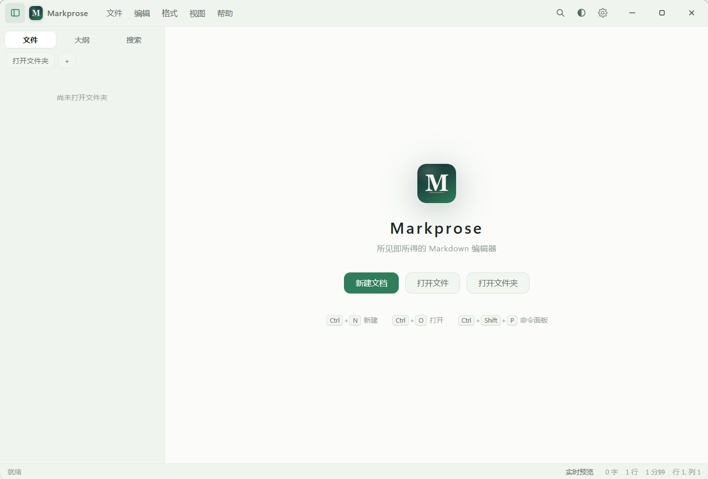
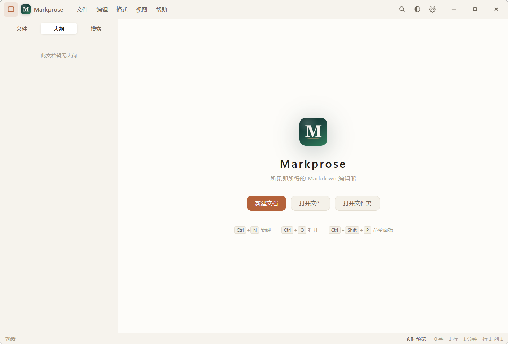
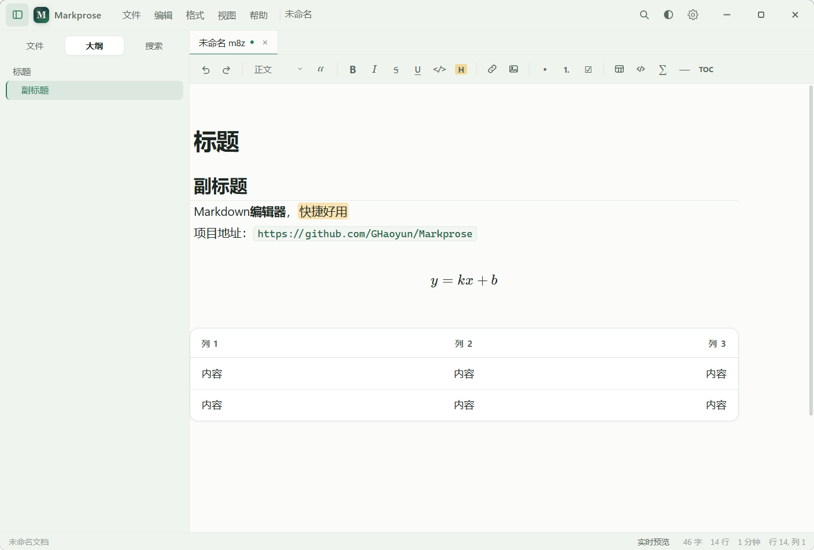
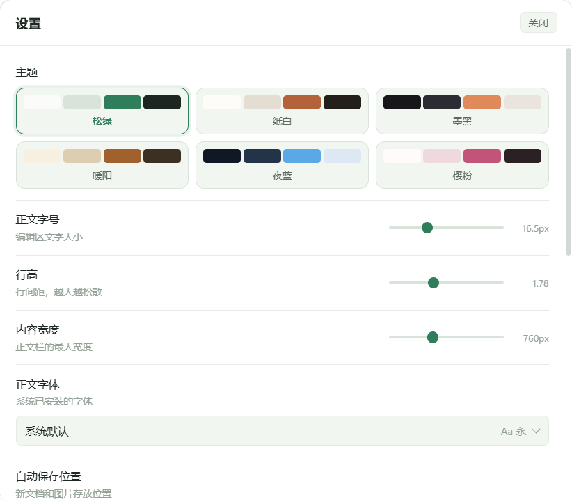

  

<h1 align="center">Markprose</h1>

<b>English</b> | <a href="README.md">简体中文</a>

  
  
  
  
  
  

A free and open-source Markdown editor for Windows x64, available as an installer and a portable build. Very small and simple, but fully featured.

## Features

Open it and start typing. Formatting marks stay hidden until you move the cursor into them; press `Ctrl+/` to see the raw source.

- Headings, bold, italic, strikethrough, underline, highlight, blockquotes, lists, task lists, code, tables, links, images
- Footnotes, math formulas, Mermaid diagrams
- Tables get their own panel — add and remove rows and columns without typing pipes
- Formulas open in a dialog with live preview; right-click one later to edit it again
- Multiple tabs, file tree, outline, full-text search
- Focus mode, typewriter mode, line numbers, zoom
- Paste or drag images straight into the document
- Export to HTML, print to PDF
- Asks before closing a tab or the window with unsaved changes
- Adjustable font size, line height, content width and typeface
- Can register itself as the default handler for `.md`

## Supported syntax

| Syntax | How to write it |
| --- | --- |
| Headings | `#` to `######`, or text underlined with `===` / `---` |
| Bold / italic | `**bold**`, `*italic*`, `***bold italic***` |
| Strikethrough | `~~text~~` |
| Underline | `<u>text</u>` |
| Highlight | `==text==` |
| Lists | `-` `*` `+`, ordered with `1.`, nest with 2–4 spaces |
| Task lists | `- [ ] todo` / `- [x] done` |
| Blockquotes | `>`, nested with `>>` |
| Code | inline backticks, fenced blocks, four-space indented blocks |
| Links | `[text](url "title")`, `<https://…>`, `[text][id]` |
| Images | ``, `` |
| Tables | pipe-separated, align with `:-` `:-:` `-:` |
| Horizontal rules | `---`, `***`, `___` |
| Escapes | `\*` `\_` `\#` and so on |
| Footnotes | `text[^1]` plus `[^1]: note` |
| Math | `$inline$`, `$$block$$` |
| Diagrams | fenced code block tagged `mermaid` |
| HTML | `<u>` `<mark>` `<kbd>` `` `` `` `
` |

## Installation

Installer: run `Markprose_1.1.1_x64-setup.exe`. On first launch it asks where to keep your documents.

Portable: run `Markprose-1.1.1-portable.exe` from any folder.

## Keyboard shortcuts

| Action | Shortcut | Action | Shortcut |
| --- | --- | --- | --- |
| New | `Ctrl+N` | Save | `Ctrl+S` |
| Open file | `Ctrl+O` | Save as | `Ctrl+Shift+S` |
| Open folder | `Ctrl+Shift+O` | Close tab | `Ctrl+W` |
| Bold | `Ctrl+B` | Italic | `Ctrl+I` |
| Strikethrough | `Ctrl+U` | Underline | `Ctrl+Shift+U` |
| Inline code | `Ctrl+E` | Highlight | `Ctrl+Shift+H` |
| Link | `Ctrl+K` | Table | `Ctrl+T` |
| Code block | `Ctrl+Shift+K` | Block math | `Ctrl+Shift+M` |
| Heading 1–6 | `Ctrl+1`…`6` | Paragraph | `Ctrl+0` |
| Find | `Ctrl+F` | Replace | `Ctrl+H` |
| Source mode | `Ctrl+/` | Sidebar | `Ctrl+\` |
| Command palette | `Ctrl+Shift+P` | Settings | `Ctrl+,` |
| Move line up / down | `Alt+↑` / `Alt+↓` | Full screen | `F11` |

## Appearance

Six colour themes: Pine, Paper, Ink, Sepia, Midnight, Sakura.

## Star History

## License

AGPL-3.0
