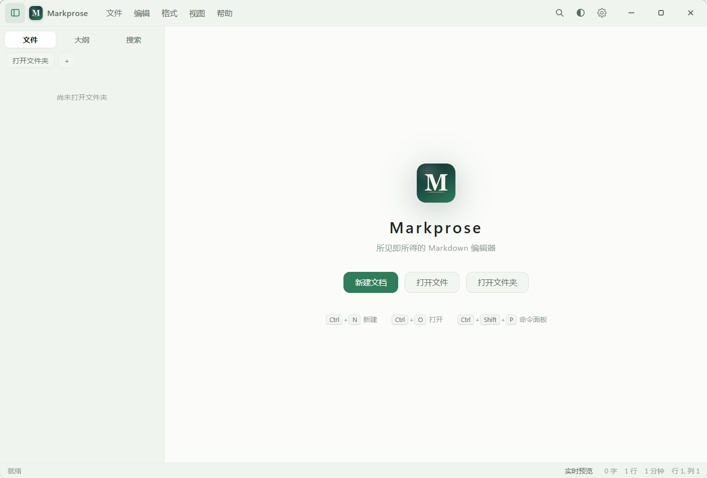
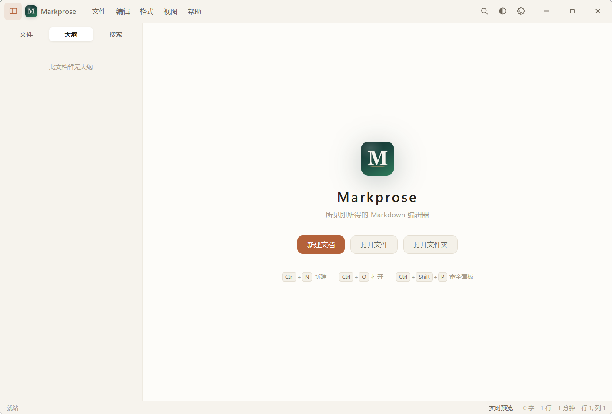
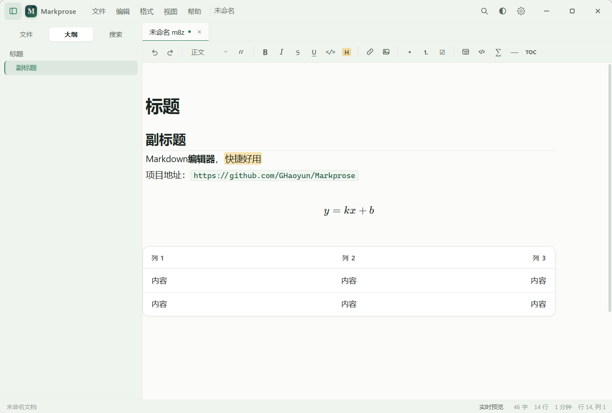
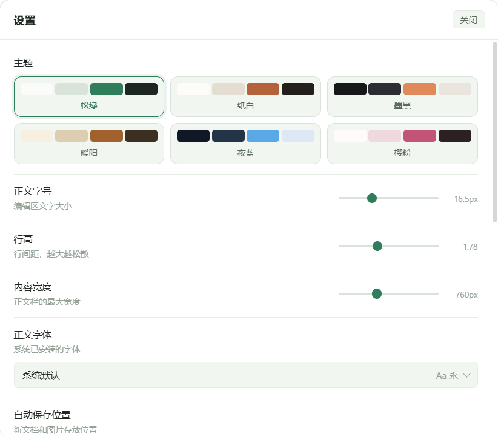

  

<h1 align="center">Markprose</h1>

<a href="README.en.md">English</a> | <b>简体中文</b>

  
  
  
  
  
  

一个免费开源的 Markdown 编辑器。Windows x64，包含便携版和安装包。非常非常小巧简洁，但是功能全面。

## 功能

打开就能写。格式标记平时不显示，光标移进去才露出来，想看原文按 `Ctrl+/` 切到源码模式。

- 标题、加粗、斜体、删除线、下划线、高亮、引用、列表、任务清单、代码、表格、链接、图片
- 脚注、数学公式、Mermaid 流程图
- 表格有独立面板，按行列增删，不用手敲竖线
- 公式带实时预览的输入框，插好之后右键还能再改
- 多标签、文件树、大纲、全文搜索
- 专注模式、打字机模式、行号、缩放
- 图片可以直接粘贴或拖进来
- 导出 HTML、打印成 PDF
- 关标签和关窗口会问要不要保存
- 正文字号、行高、内容宽度、正文字体都能调
- 可以把 `.md` 关联成默认打开方式

## 支持的语法

| 语法 | 写法 |
| --- | --- |
| 标题 | `#` ~ `######`，或文字下面跟 `===` / `---` |
| 粗体 / 斜体 | `**粗体**`、`*斜体*`、`***粗斜体***` |
| 删除线 | `~~删除~~` |
| 下划线 | `<u>下划线</u>` |
| 高亮 | `==高亮==` |
| 列表 | `-` `*` `+`，有序用 `1.`，缩进 2–4 空格嵌套 |
| 任务清单 | `- [ ] 未完成` / `- [x] 已完成` |
| 引用 | `>`，支持 `>>` 嵌套 |
| 代码 | 行内反引号、围栏代码块、四空格缩进块 |
| 链接 | `[文字](url "标题")`、`<https://…>`、`[文字][id]` |
| 图片 | ``、`` |
| 表格 | 竖线分隔，`:-` `:-:` `-:` 控制对齐 |
| 分隔线 | `---`、`***`、`___` |
| 转义 | `\*` `\_` `\#` 等 |
| 脚注 | `文字[^1]` + `[^1]: 说明` |
| 公式 | `$行内$`、`$$块级$$` |
| 图表 | 围栏代码块标注 `mermaid` |
| HTML | `<u>` `<mark>` `<kbd>` `` `` `` `
` |

## 安装

安装包：运行 `Markprose_1.1.1_x64-setup.exe`，装完首次启动会让你选文档保存位置。

便携版：`Markprose-1.1.1-portable.exe` 放到任意目录直接运行。

## 快捷键

| 操作 | 快捷键 | 操作 | 快捷键 |
| --- | --- | --- | --- |
| 新建 | `Ctrl+N` | 保存 | `Ctrl+S` |
| 打开文件 | `Ctrl+O` | 另存为 | `Ctrl+Shift+S` |
| 打开文件夹 | `Ctrl+Shift+O` | 关闭标签 | `Ctrl+W` |
| 加粗 | `Ctrl+B` | 斜体 | `Ctrl+I` |
| 删除线 | `Ctrl+U` | 下划线 | `Ctrl+Shift+U` |
| 行内代码 | `Ctrl+E` | 高亮 | `Ctrl+Shift+H` |
| 链接 | `Ctrl+K` | 表格 | `Ctrl+T` |
| 代码块 | `Ctrl+Shift+K` | 块级公式 | `Ctrl+Shift+M` |
| 标题 1–6 | `Ctrl+1`…`6` | 正文 | `Ctrl+0` |
| 查找 | `Ctrl+F` | 替换 | `Ctrl+H` |
| 源码模式 | `Ctrl+/` | 侧边栏 | `Ctrl+\` |
| 命令面板 | `Ctrl+Shift+P` | 设置 | `Ctrl+,` |
| 上移 / 下移该行 | `Alt+↑` / `Alt+↓` | 全屏 | `F11` |

## 外观

六套配色：松绿、纸白、墨黑、暖阳、夜蓝、樱粉。

## Star History

## 许可证

AGPL-3.0
